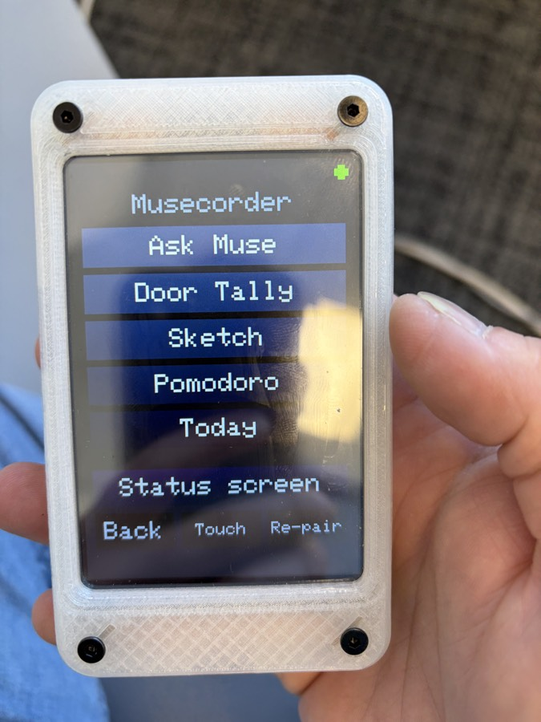
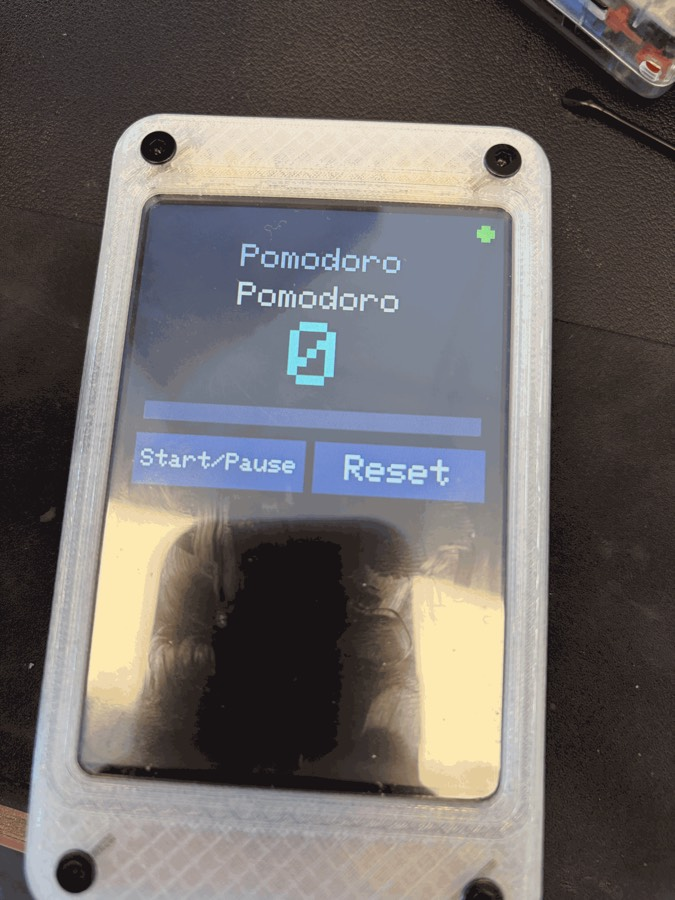
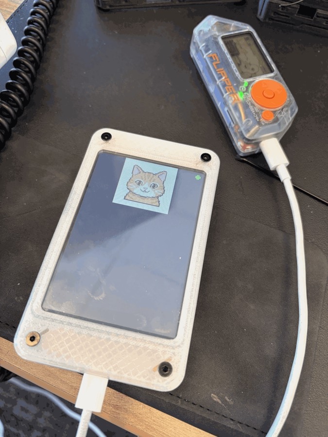

# Musecorder

### A Muse tricorder: an ESP32 touchscreen your Muse pairs with from the phone app and **recodes in seconds** for whatever job is in front of you. No reflash, no API key, no laptop.

*AITL (AI In The Loop) · Caeruli Obscuri Laboratorium · built for the Meta Global AI Developer Hackathon, October 2026*

```
   you, in the Muse app                 Meta's cloud                       Musecorder (ESP32 touchscreen)
 ┌────────────────────────┐   "make it a people counter"   ┌───────────┐   encrypted session   ┌──────────────────────────┐
 │  "Install an applet    │ ─────────────────────────────▶ │ your Muse │ ◀═══════════════════▶ │ Meta Muse Gadget firmware│
 │   that counts people   │                                │  (VM)     │   applet.install      │  + Musecorder runtime    │
 │   through door A and   │ ◀───────────────────────────── │           │ ─────────────────────▶│   JSON applets, hot-     │
 │   tells me every 5 min"│   "done, it's on the screen"   └───────────┘   muse.say "tally 37"  │   loaded in ~2 s         │
 └────────────────────────┘                                      ▲      ◀───────────────────── │  touch buttons, canvas,  │
                                                                 │        applet.state / event  │  launcher, speaker, GPIO │
                                                       Muse replies in the app                  │  ADC, PWM, I2C, HTTP     │
                                                                                                └──────────────────────────┘
```

<p align="center">  </p>
<p align="center"><i>Left to right: the launcher with five applets Muse wrote (door tally, sketch pad, pomodoro, today's calendar, ask Muse); the pomodoro; a cat Muse generated on its VM and drew over the encrypted session in 307 ms. Submission notes: <a href="docs/SUBMISSION.md">docs/SUBMISSION.md</a>.</i></p>

## The idea

You are at a ball game and your job is to count people through door A and report every five minutes. You tell your
Muse, in the Muse app. Muse writes a 20-line JSON **applet**, sends it to the Musecorder over the encrypted session
Meta's Gadget SDK gives every paired device, and two seconds later the device is a people counter: a big number,
+1 / −1 / reset touch buttons, a progress bar, a beep every tenth person, and a timer that posts "Door A: 37 so far"
into your Muse chat, where Muse can log it, chart it, or nag you. No compiler, no reflash, no reboot, no API key: it
rides on the Muse account you already have. Tomorrow it is a dice, a sketch pad, a voltmeter, an I²C scanner, a
pomodoro timer, a doorbell that pings your Muse.

Applets are data, not code. A bad one cannot brick the device: the firmware image is never touched, the applet
store is its own flash partition, and the launcher (tap the title) or `applet.remove` always brings the status
screen back. Up to five applets stay on the device; tap the title bar to switch.

## What works today (gadget mode, demoed on the 4" Hosyond ESP32 board)

| Feature | Where |
|---|---|
| Pairs with the Muse app over BLE (community pairing v5), joins Wi-Fi, holds the Noise-encrypted control session to your Muse's VM; `link.register` advertises the device's commands | Meta's SDK + `gadget/port/apply.py` (CYD ILI9341 and ST7796 status backends, small-RAM session buffers) |
| **Applet runtime inside Meta's firmware**: `applet.install / remove / state / event`; JSON screens (text, big numerals, bars, touch buttons, free canvas), state with persistence, `${expr}` templates, handlers for touch, BOOT, timers, GPIO edges and custom events | `gadget/port/musecorder/` |
| Actions: `tone` (speaker), `led`, `pwm`, `gpio.read/write`, `adc.read`, `i2c.scan/read/write`, `draw.rect/text`, `http`, `muse.say` (posts into your Muse chat), `muse.ask`, `vm.write` | same |
| Touchscreen: XPT2046 (resistive, on the LCD bus) or CST820 (capacitive, I²C), 3-tap on-screen calibration, launcher with the stored applets | same |
| Images from Muse: `display.draw_file` straight from Muse's VM over the encrypted session (160 px JPEG in 307 ms), `display.draw_url` over plain `http://`, Meta's status animation replaced by your own Muse sprite | `gadget/port/gen_avatar_anim.py` |
| Verified applets Muse wrote unaided from one sentence each: door tally, pomodoro, dice, sketch pad, today's calendar (Muse reads Google Calendar on its VM and puts the events on the device) | the Muse app |
| Several Wi-Fi networks: `wifi.add/list/forget` from Muse, or `gadget/wifi.py` over USB from a gitignored `.env` | `gadget/wifi.py` |
| microSD card, mounted only while in use: logs from applets, and an offline image cache (`sd` fetch from Muse's VM, draw from the card) | `gadget/port/musecorder/musecorder_sd.c` |
| Ready-made applets to paste into the Muse chat: door tally, sketch pad, dice, voltmeter, I²C scanner | [`examples/gadget/`](examples/gadget/) |

The **Mac-bridge personality** (the original AITL firmware: chat with Muse Spark on the device, Muse Code sessions and
tool approvals on the touchscreen, an LVGL applet engine driven by a Muse Code MCP server and skill, BLE keyboard,
dictation) still lives in `firmware/` and `bridge/`; see [Bridge mode](#bridge-mode-the-mac-personality) below. The two
personalities are two flash images you swap in 40 s.

## Quick start (gadget mode)

**Hardware:** Hosyond 4.0" ESP32-32E (ST7796, `BOARD=cyd40`) or Sunton ESP32-2432S024C 2.4" (`BOARD=cyd24`). Any
classic ESP32 "Cheap Yellow Display" is a profile away. A board with PSRAM (Freenove FNK0104B, Waveshare
ESP32-S3-Touch-LCD-7) lifts the memory limits noted below.

```sh
# 1. once: ESP-IDF v6.0.1 at ~/esp/esp-idf-v6, an SDK token from gadgets.muse.ai in .env as MUSE_GADGET_SDK_TOKEN
# 2. build Meta's firmware with the port applied (the SDK clone lives in ~/esp, outside this repo)
BOARD=cyd40 gadget/build.sh
# 3. flash and pair: Muse app > Settings > Devices > Developer mode > Add device > MuseGadget-CYD4-xxxxxx, press BOOT
BOARD=cyd40 gadget/flash.sh /dev/cu.usbserial-110
# 4. in the Muse app:
#    "Install this applet on my gadget: <paste examples/gadget/door-tally.json>"
#    "Make the gadget a dice with a Roll button that plays three notes"
#    "What does the tally applet say right now?"          (applet.state)
```

Details, pairing notes, memory limits and the command reference: [`gadget/README.md`](gadget/README.md).
Demo script and submission notes: [`docs/DEMO.md`](docs/DEMO.md).

## Applet in 30 seconds

```json
{"id":"dice","name":"Dice","state":{"n":1,"rolls":0},"persist":["rolls"],
 "screen":[{"big":"${n}"},{"text":"${rolls} rolls"},{"button":"Roll","event":"roll"}],
 "on":{"roll":[{"set":{"n":"${random(1,6)}"}},{"inc":"rolls"},{"tone":{"freq":[523,659,784],"ms":50}}],
       "boot:press":[{"set":{"n":"${random(1,6)}"}},{"inc":"rolls"}]}}
```

`screen` is a list of rows; `on` maps events to action lists; `${}` evaluates against `state`. The whole format is in
the description Muse receives with `applet.install` (`gadget/port/musecorder/musecorder.h`), so Muse needs no docs.

## Bridge mode (the Mac personality)

The original firmware (`firmware/`, PlatformIO, LVGL 8.3) plus a Python bridge (`bridge/`): chat with Muse Spark
from the device, list and resume Muse Code sessions with tool approvals on the touchscreen, and an LVGL applet
engine (`docs/APPLETS.md`) that Muse Code drives through an MCP server and a project skill. It also keeps everything
AITL did: BLE HID keyboard, dictation into the Mac, clipboard actions, device mic, signed Wi-Fi link.

```sh
cd firmware && pio run -e hosyond40r -t upload        # or cyd24c; first boot runs a setup wizard
cd ../bridge && python3 -m venv .venv && . .venv/bin/activate && pip install -e ".[discovery]"
musecorder serve                                       # the device shows "USB" in green
muse login && musecorder muse-setup && cd .. && muse   # Muse Code with the musecorder skill + MCP server
```

## Repository layout

```
gadget/          Meta Muse Gadget SDK port: build/flash scripts, port/apply.py (patches), port/musecorder (applet runtime),
                 port/avatar (your Muse as the status sprite), board sdkconfigs, partition table with the applet store
examples/gadget  applets to paste into the Muse chat
firmware/        PlatformIO project for bridge mode (ESP32 Arduino, LVGL 8.3, LovyanGFX). src/applets = the LVGL engine
bridge/          Python package `musecorder`: providers, applet relay, MCP server, CLI, tests
.agents/skills/  Muse Code skill for bridge mode
docs/            DEMO, APPLETS (bridge-mode spec), PROTOCOL, HARDWARE, SECURITY, UI
tools/           flash.sh, erase.sh, monitor.sh, probe/
AGENTS.md        what a coding agent needs to build, flash and extend this project
```

## Security in one paragraph

Gadget mode holds no API key at all: the device carries Meta's pairing credential, the session is Noise-encrypted end
to end, and every command Muse can run is one the firmware registered. Applets touch only a short GPIO allowlist, the
runtime caps every buffer, and the applet store is a separate flash partition from Meta's pairing data. Bridge mode
keeps keys in the Mac's Keychain and signs Wi-Fi frames (see [`docs/SECURITY.md`](docs/SECURITY.md)).

## Roadmap

- A PSRAM board profile (Freenove 2.8" or Waveshare 7") for Meta's full avatar UI, HTTPS from applets and the Muse
  reply read back onto the screen (`muse.ask`).
- Chart and gauge rows; a few more I²C helpers (temperature, IMU) as applet actions.
- OTA so native changes by Muse land without a cable.

*Decision support, not decision authority.* — UNCLASSIFIED // OPEN SOURCE
