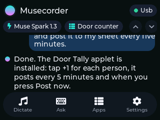
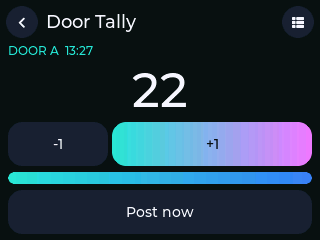
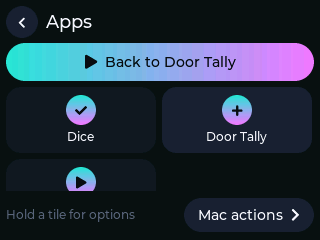
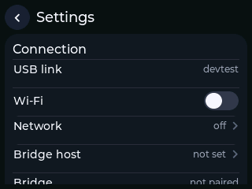

# Musecorder

### A Muse tricorder: an ESP32 touchscreen that Meta's Muse can talk through, manage coding sessions on, and **recode in seconds** for whatever job is in front of you.

*AITL (AI In The Loop) · Caeruli Obscuri Laboratorium · built for the Meta Global AI Developer Hackathon, October 2026*

```
 ┌───────────────────────────┐        USB / Wi-Fi / BLE        ┌──────────────────────────────┐
 │  Musecorder  (ESP32 CYD)  │ ◀──────── NDJSON link ─────────▶ │  musecorder bridge  (your Mac)│
 │  • chat with Muse Spark   │                                  │  • Meta Model API (Muse Spark)│
 │  • Muse Code sessions +   │   applet.install  (≈2 s)         │  • Muse Code sessions (MSP)   │
 │    approvals on screen    │ ◀─────────────────────────────── │  • applet relay + HTTP proxy  │
 │  • APPLET ENGINE          │   applet.ui / state / events     │  • MCP server for Muse Code   │
 │    JSON tools, hot-loaded │ ────────────────────────────────▶│  • macOS typing / dictation   │
 │  • BLE keyboard, mic, SD  │                                  └──────────────┬───────────────┘
 └───────────────────────────┘                                                 │ MSP (stdio)
                                                                      ┌────────▼────────┐
         "make the device a people counter that posts to my sheet"    │   Muse Code     │
         ─────────────────────────────────────────────────────────▶   │  (skill + MCP)  │
                                                                      └─────────────────┘
```

<p align="center"> </p>
<p align="center"> </p>
<p align="center"><i>Captured from the panel itself over the link (<code>musecorder screenshot</code>). Left to right: home with a Muse conversation, the door-tally applet, the launcher, settings.</i></p>

## The idea

You are at a ball game and your job is to count people through door A and post the tally every five minutes. You
tell Muse. Muse writes a 40-line JSON **applet**, validates it, pushes it to the Musecorder over the link, reads the
screen back to check its work, and the device is now a people counter: a 48 px number, +1 / −1, a status line, a
timer that posts to your Google Sheet webhook. No compiler, no reflash, no reboot. Tomorrow it is a pomodoro timer,
a GPIO edge counter, a dice, a macro pad, a sensor dashboard.

When an applet needs something the engine does not have (a new sensor driver, a protocol), Muse edits the firmware
itself: the repo carries an `AGENTS.md` with the build and flash recipe, and the applet engine is written to be
extended (`firmware/src/applets/`).

## What works today

| Feature | Where |
|---|---|
| Applet engine: JSON screens (labels, 48 px numerals, buttons, rows, toggles, sliders, bars, inputs, logs), state with persistence, expression templates `${count + 1}`, handlers on tap / hold / timers / GPIO edges / BOOT button, actions for HTTP (through the bridge or the device's own Wi-Fi), ask-the-AI, LED, beep, pins, typing into the host, notifications | `firmware/src/applets/`, spec in [`docs/APPLETS.md`](docs/APPLETS.md) |
| Install / list / open / remove / state / events / screen read-back over the link, chunked for documents up to 12 KB; flash store survives power cycles; `autostart` kiosk mode | `docs/APPLETS.md` §6 |
| Launcher (APPS) with one tile per applet, hold to remove, escape hatch (hold BOOT 3 s) | `firmware/src/applets/applet_ui.cpp` |
| Chat with Muse Spark from the device, streamed token by token; model picker; multiple chats | bridge `providers/muse_provider.py` |
| Muse Code sessions listed and resumed from the device; tool approvals pop up on the touchscreen with Allow / Deny | bridge `providers/muse_code_provider.py` |
| Muse Code drives the device: MCP server (`applet_install`, `applet_screen`, `device_screenshot` (a real PNG of the panel), `applet_state_get`, …) + a project skill that teaches the applet format | `bridge/musecorder/mcp_server.py`, `.agents/skills/musecorder/` |
| Everything AITL already did: BLE HID keyboard, dictation into the Mac, clipboard actions, device mic, Wi-Fi link with signed frames, first-boot wizard, settings | `docs/` |

## Quick start

**Hardware:** an ESP32-2432S024C (2.4" capacitive "Cheap Yellow Display"). Other CYD sizes have board profiles in
`firmware/boards/`.

```sh
# 1. Firmware (PlatformIO)
cd firmware && pio run -e cyd24c -t upload            # first boot runs a 20-second setup wizard on the device

# 2. Bridge on the Mac
cd ../bridge && python3 -m venv .venv && . .venv/bin/activate && pip install -e ".[discovery]"
musecorder keys set muse                               # Meta Model API key (or export META_API_KEY)
musecorder serve                                       # the device shows "USB" in green

# 3. Muse Code
muse login                                             # once
musecorder muse-setup                                  # registers the MCP server + installs the skill
cd .. && muse                                          # in this repo; then ask:
#   > make the device a people counter for door A that posts the tally to <webhook> every 5 minutes
```

Without Muse Code you can push applets by hand: `musecorder applet install examples/applets/door-tally.json --open`,
then `musecorder applet ui` to see what the device shows.

## Applet in 30 seconds

```json
{ "id": "dice", "name": "Dice", "icon": "shuffle",
  "state": { "n": 1 },
  "ui": [ { "type": "label", "text": "${n}", "size": "xxl", "align": "center" },
          { "type": "button", "text": "Roll", "style": "primary", "do": [ { "set": { "n": "${random(1, 6)}" } }, { "beep": { "freq": 660, "ms": 40 } } ] } ],
  "on": { "boot:press": [ { "set": { "n": "${random(1, 6)}" } } ] } }
```

Full reference: [`docs/APPLETS.md`](docs/APPLETS.md). Examples: [`examples/applets/`](examples/applets/).

## Repository layout

```
firmware/        PlatformIO project (ESP32 Arduino, LVGL 8.3, LovyanGFX). src/applets = the engine
bridge/          Python package `musecorder`: providers, applet relay, MCP server, CLI, tests
.agents/skills/  Muse Code skill: how to author and install applets
examples/        applets you can install as-is
docs/            APPLETS (spec), PROTOCOL, HARDWARE, SECURITY, UI
tools/           flash.sh, erase.sh, monitor.sh, probe/
AGENTS.md        what a coding agent needs to build, flash and extend this project
```

## Security in one paragraph

API keys live in the Mac's Keychain and never reach the device. USB possession is the credential for the cable;
Wi-Fi frames are HMAC-signed with per-session nonces; the bridge's control plane is loopback-only. Applets can only
touch a short allowlist of GPIOs, HTTP from an applet is proxied through the bridge with size and rate caps, and the
device holds no secrets beyond Wi-Fi credentials (see [`docs/SECURITY.md`](docs/SECURITY.md)).

## Roadmap

- Official Muse Gadget pairing (Meta's ESP-IDF gadget SDK) as a second firmware personality, so the Muse phone app can reach the device directly.
- Chart and gauge widgets; I²C sensor actions (`i2c.read`) so Muse can wire up new peripherals without native code.
- OTA flashing from the bridge so native changes by Muse land without a cable.
- The 4" and 3.5" CYD boards (profiles exist; need touch calibration passes).

*Decision support, not decision authority.* — UNCLASSIFIED // OPEN SOURCE
