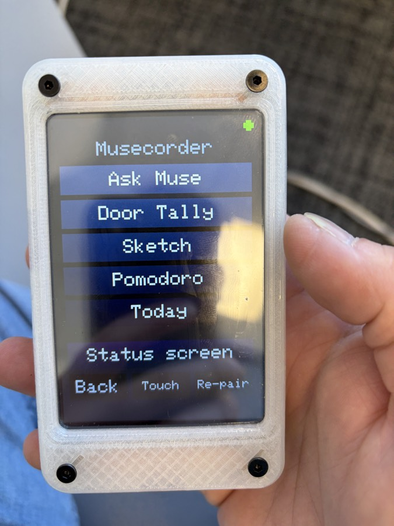
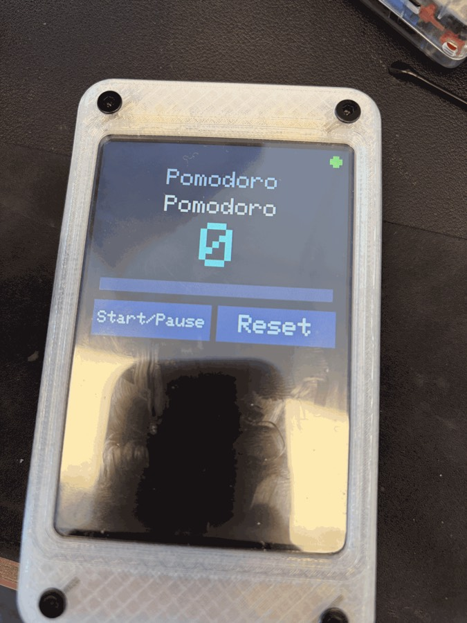
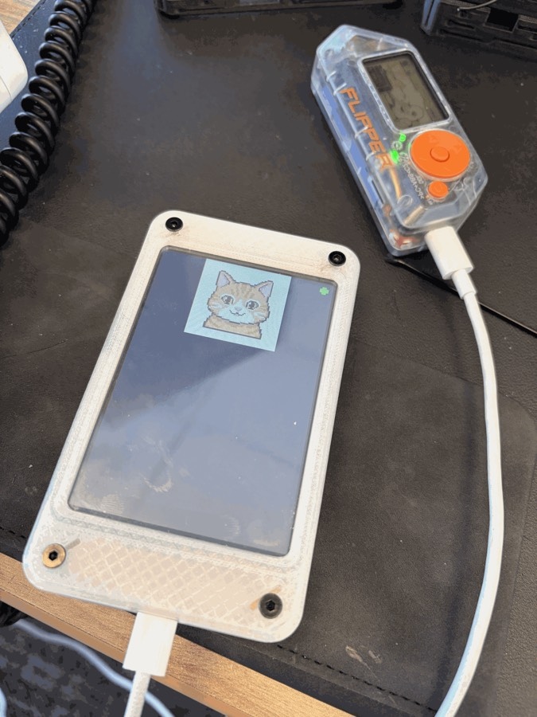

# Musecorder — submission notes for the Meta Global AI Developer Hackathon

**One line:** a $20 ESP32 touchscreen that pairs with your Muse from the phone app and is re-programmed by Muse, in
seconds, for whatever job is in front of you: a people counter, a pomodoro timer, today's calendar, a sketch pad,
a voltmeter, a picture frame. No reflash, no laptop, no API key: it rides on the Muse account you already have.

*Indie track · Brayden Anthony H. · repo `hord-brayden/aitl-meta-Hackathon` · built 26–27 October 2026 (continuing)*

  

## What it does

1. **Pairs like any Muse gadget.** Meta's open-source Muse Gadget SDK firmware, ported to a classic ESP32 "Cheap Yellow
   Display" board (no PSRAM, 4 MB flash). BLE pairing from the Muse app, Wi-Fi, a Noise-encrypted control session to
   your Muse's VM. The status screen shows your own Muse avatar, converted into Meta's sprite format.
2. **Muse writes tools for it.** The firmware carries a small applet runtime. You say, in the Muse app, *"make my gadget a
   pomodoro timer with Start/Pause and Reset, and post into this chat when a session ends"*. Muse writes a ~1 KB JSON
   applet (screen rows, state, event handlers, actions), calls `applet.install`, and the screen changes two seconds
   later. The whole applet language rides in the command description Muse receives when the device registers, so Muse
   needs no documentation and gets it right on the first try. Verified applets written by Muse unaided: door tally with
   touch buttons, pomodoro, dice, sketch pad, **today's calendar** (Muse read the user's Google Calendar on its VM and
   put the events on the device, ordered, with times).
3. **It talks both ways.** Muse reads device state any time (`applet.state`). The device posts into your Muse chat on
   its own (`muse.say`): a timer that fires, a count that crosses a threshold, a button marked "Post to Muse".
4. **Muse draws on it.** Images Muse generates land on the screen through Meta's `display.draw_file` over the same
   encrypted session (a 160 px JPEG in 307 ms), plus a vector drawing API in applets (`draw.rect`, `draw.text`) and a
   finger-driven canvas.
5. **Hardware is reachable from the chat.** Applet actions for the speaker (`tone`), PWM, GPIO in/out, ADC, I²C
   scan/read/write, the RGB LED, HTTP, and the microSD card: logs that need no network, and an offline image cache (the cat
   copied from Muse's VM to the card in 540 ms, drawn from the card in 280 ms, no download).
6. **Phone-free use.** A touch launcher (hold a finger for a second) switches between the five stored applets,
   recalibrates touch, or re-pairs; a tap confirms pairing. Applets persist across power cycles in their own flash
   partition. Three Wi-Fi networks are stored; Muse can teach it more (`wifi.add`).
7. **It cannot brick itself.** Applets are data, never code. The firmware image is never written by Muse; the applet
   store is a separate partition; `applet.remove` or the launcher always returns to the status screen.

## How Muse is used

- **Muse Gadget SDK** (ESP-IDF): pairing, Wi-Fi provisioning, the Noise control session, `link.register` (the device
  advertises 17 commands: Meta's `device.*` and `display.*`, plus `applet.install/remove/state/event`,
  `wifi.add/forget/list`, `sd`), `link.invoke` from Muse, and the chat route Meta's own boards
  use (`POST /chat/stream`) for the device-to-chat push.
- **The Muse app** is the only user interface for programming the device. Muse authors every applet from a natural
  language request; the device's command description is the spec.
- **Muse's VM** generates and stores images the device fetches; Muse's tools (calendar, web) feed applet state.
- Bridge mode (secondary, in `firmware/` and `bridge/`): the original AITL firmware with **Muse Code** sessions and
  tool approvals on the touchscreen, and an MCP server plus skill so Muse Code drives an LVGL applet engine.

## What was built here versus what Meta provides

| Meta's SDK gives | This project adds (`gadget/port/`) |
|---|---|
| Pairing, Wi-Fi, Noise session, command registry, status-bar display backends for Meta's boards, image fetch and JPEG decode, chat routes | Board port for CYD boards (ILI9341 and ST7796 panels, BGR, mirror), session buffers trimmed to fit a no-PSRAM ESP32 (pairing works with ~30 KB free), random static BLE address |
| | `musecorder.cpp`: the applet runtime (expression evaluator, templates, timers, GPIO/ADC/PWM/I²C/tone actions, touch targets, canvas, launcher, calibration wizard, applet store in its own NVS partition, device-to-chat push) |
| | Touch on the shared LCD SPI bus (XPT2046) and the CST820 on the 2.4" board; touch stand-ins for the BOOT button |
| | Multi-network Wi-Fi: `wifi.*` commands and a serial console for adding networks over USB from a gitignored `.env` |
| | Your Muse as the status sprite (GIF to Meta's cell-sprite converter) |
| | microSD: mount-on-demand logging, VM-to-card fetch in Range chunks over the session, card-to-screen through Meta's decoder (file source patch) |

## Numbers

| | |
|---|---|
| Board | Hosyond 4.0" ESP32-32E, ST7796 320×480, resistive touch, no PSRAM (also Sunton 2.4" CYD) |
| Free RAM with an applet running and the session up | ~54 KB internal, ~26 KB DMA-capable |
| Applet install, phone to screen | ~2 s |
| 160 px JPEG from Muse's VM to screen | 307 ms |
| Applet spec Muse receives | 1.6 KB (inside a 5.7 KB registration) |
| Stored applets | 5 × 4 KB in flash; files and logs on the microSD card |

## Honest limits
- No PSRAM: HTTPS from applets fails (needs a 17 KB block), Muse's chat *reply* is not read back onto the screen
  (16 KB frames), images stay around 160–240 px. A PSRAM board (profile planned) removes all three.
- The VM refuses `/fs/write` for this device credential (server-side scope), so the device cannot write Muse's files;
  `muse.say` and `applet.state` cover it.
- Resistive touch wants a firm press.

## Reproduce
`docs/DEMO.md` has the demo script; `README.md` and `gadget/README.md` the build. A fresh machine needs ESP-IDF
v6.0.1, an SDK token from gadgets.muse.ai in `.env`, then `BOARD=cyd40 gadget/build.sh` and `gadget/flash.sh`. The
GitHub release carries the exact firmware binary used for these results, flashable with esptool alone.
