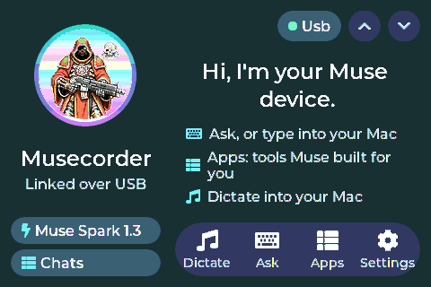
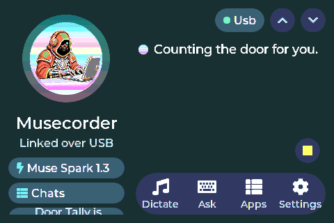

# Screen map (320×240 landscape by default; every layout is flex-based and also works in portrait)

```
BOOT        orb · "Musecorder" · tagline · quiet boot log
SETUP       Welcome (orb, "Hi, I'm your Muse device.") → touch calibration → orientation → colors
HOME        top bar: orb (status: breathing = idle, fast = thinking, amber = needs you, grey = offline) · wordmark · bell · link pill
            chips: model · chat (hold = new chat) · page up/down
            conversation: user messages in right-aligned bubbles, Muse replies plain with an orb dot; floating stop/copy/paste
            dock: Dictate · Ask · Apps · Settings
MODELS      grouped by provider, gradient dot marks the current one
CHATS       New chat (gradient pill) · chats · Muse Code sessions; hold a chat to delete
APPS        2-column tiles with gradient badges; "Back to <app>" when one runs in the background; "Mac actions" pill
APP         a running applet: back · name · ☰ (launcher) · the applet's widgets (docs/APPLETS.md). Hold BOOT 3 s to leave
MAC ACTIONS one-tap prompts from config.toml + media / key tiles
ASK         textarea + keyboard; top row: ✕ · mic · Ask ▸ · Mac ▸
SETTINGS    grouped cards: Connection · Bluetooth · Voice · Display · Touch · Apps · Storage · About
PAIR        bridge name · 6-digit code · certificate fingerprint · They match / Reject
CALIBRATE   3 rings (hold each 0.65 s) → "Check it" verify screen with a dot under your finger → Looks right / Redo
TOUCH TEST  draw on a grid; raw + mapped coordinates; Recalibrate / Clear / Done
```

Design language (`firmware/src/ui/theme.h`): a Muse-flavoured look. Charcoal surfaces (#0f1117 page, #171a23 cards,
#1f2330 pills), text #f3f4f8 / muted #9aa3b5, one iridescent accent (teal #2ee6d6 → magenta #e879f9) used only on the orb,
primary pills, badges and progress indicators; success #34d399, warning #fbbf24, danger #fb7185. Cards radius 16, actions
are full pills, tiles radius 12–14, no borders (elevation by lighter surface), hairlines only between rows. Montserrat
12/14/16/18/20/28 + 48 for applet numerals; sentence case everywhere. The orb (`theme::orb`) is the signature element: a
gradient circle with a breathing halo that doubles as the device's status. Touch targets ≥ 34 px.

## Large-screen profile (`AITL_UI_BIG`, 480×320 boards such as `hosyond40r`)
`theme::big()` switches to a 12/16/24 px rhythm: 18 px body, 24 px titles, 52 px rows, 56 px buttons, 60 px dock.
Home becomes two panes: left (38 %) orb 104 px, wordmark, link status, model and chat chips, background-applet pill;
right: bell / link pill / page buttons, the conversation, floating stop·copy·paste, the dock. Apps is a 3-column grid
with the "Back to …" and "Mac actions" pills in a top row. Applet content is a 420 px column centered on screen
(`xl` numerals 36, `xxl` 48, charts 140 px). Settings lays its cards in two columns. Boot: orb 140, wordmark 28.
Draw buffers on 480-wide panels are 2 × 480×12 (23 KB) so ≈ 80 KB of heap stays free with an applet on screen.
Captures: `docs/img/4in-*.png`.

## Avatar

The orb shows your Muse avatar. Sources live in `assets/avatar/` (`still.jpg` plus the `typing/` frames exported from the
Muse app); `tools/avatar_to_lvgl.py` turns them into `firmware/src/ui/avatar_img.c` (the still) and `avatar_anim.c`
(the typing loop), both checked in so a clean clone builds with the face on. Regenerate after swapping the images:

    python3 tools/avatar_to_lvgl.py assets/avatar/still.jpg --key-white --round --crop 30,0,180,180 \
        --frames assets/avatar/typing --step 2 --frames-crop 0,0,240,240 --preview /tmp/avatar.png

`--key-white` makes a white export background transparent so the orb gradient shows behind the figure; `--round` masks
it to the circle; `--preview` writes a strip of the still and every frame on the gradient so you can judge the crop
before flashing. The still is drawn while Muse is idle; while a reply streams (`Orb::Busy`) the orb plays the typing
frames at ~9 fps straight from flash (no RAM cost; about 28 KB of flash per 98×98 frame).

 
